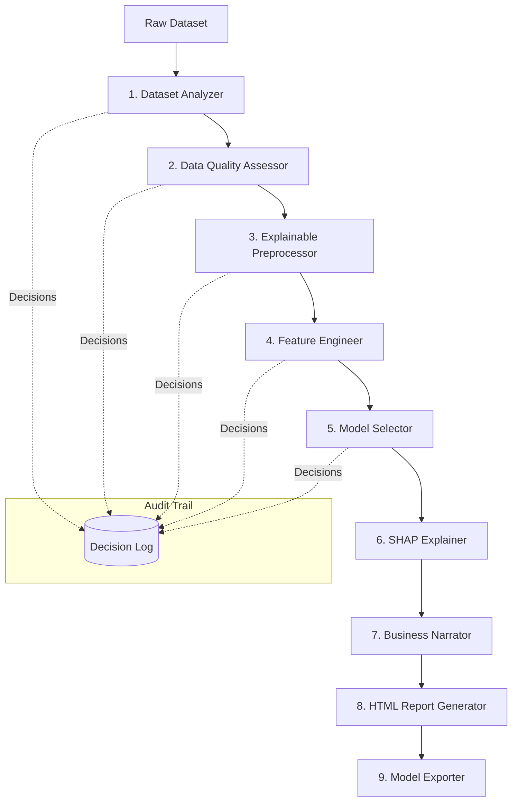

# MentorML — Explainable AutoML Framework

<div align="center">

[](https://www.python.org/downloads/)
[](https://github.com/ronitgulia/AutoML-Framework/actions/workflows/ci.yml)
[](LICENSE)
[](https://github.com/psf/black)

**The AI Data Scientist Copilot that reasons, audits, and narrates like a senior data scientist.**

[Quick Start](#-quick-start) · [Pipeline Architecture](#%EF%B8%8F-pipeline-architecture) · [Decision Engine](#-the-decision-engine) · [Configuration](#%EF%B8%8F-configuration-options) · [Running Tests](#-running-tests)

</div>

---

> Most AutoML tools silently optimize a metric and hand you a model. **MentorML explains the *why* behind every single decision it makes** — from which columns it dropped, to why it chose LightGBM over XGBoost — written in plain English your whole team can understand.

---

## 🌟 What Makes MentorML Different

| Feature | Generic AutoML | **MentorML** |
|---|---|---|
| Model selection | ✅ Black box | ✅ **Fully explained** |
| Preprocessing decisions | ✅ Silent | ✅ **Logged with rationale** |
| Data quality audit | ⚠️ Basic | ✅ **In-depth, with severity tags** |
| Feature importance | ⚠️ Sometimes | ✅ **SHAP-powered, always** |
| Business narrative | ❌ None | ✅ **Plain-English summaries** |
| HTML report | ⚠️ Basic | ✅ **Interactive dashboard** |
| Audit trail | ❌ None | ✅ **Immutable `DecisionLog`** |
| Inference export | ✅ Sometimes | ✅ **Drop-in `infer.py`** |

---

## 🚀 Quick Start

### Installation

```bash
git clone https://github.com/ronitgulia/AutoML-Framework.git
cd AutoML-Framework
pip install -r requirements.txt
```

### End-to-End Pipeline in 5 Lines

```python
import pandas as pd
from mentorml import MentorPipeline, MentorConfig

df = pd.read_csv("customer_churn.csv")

config = MentorConfig(
    target_column="churn",
    task_type="classification",
    cv_folds=5,
    verbose=True,
)

pipeline = MentorPipeline(config=config, project_name="Customer Churn Prediction")
result = pipeline.fit(df)

print(result.narrative)
print(f"HTML Report: {result.report_path}")
print(f"Exported artifacts: {result.export_dir}")
```

That is it. MentorML handles profiling, cleaning, encoding, model selection, explainability, and export automatically.

---

## 🏛️ Pipeline Architecture

A single call to `MentorPipeline.fit()` triggers a structured **9-phase lifecycle**. Every phase logs its decisions to a shared, immutable `DecisionLog`.



### The 9-Phase Lifecycle

| Phase | Component | What It Does |
| :--- | :--- | :--- |
| **1. Analysis** | `DatasetAnalyzer` | Column profiling, type inference, skewness and correlation matrices |
| **2. Quality** | `DataQualityAssessor` | Duplicates, outliers (IQR), missing patterns, class imbalance checks |
| **3. Preprocessing** | `ExplainablePreprocessor` | Adaptive encoding, skewness-aware scaling, intelligent column pruning |
| **4. Features** | `FeatureEngineer` | Interaction terms, polynomial features, collinearity pruning |
| **5. Modeling** | `ModelSelector` | Cross-validated multi-model tournament — LightGBM, XGBoost, CatBoost, RF |
| **6. Explainability** | `SHAPExplainer` | TreeSHAP global and local feature importance |
| **7. Narrative** | `BusinessNarrator` | Plain-English executive summary and strategic recommendations |
| **8. Reporting** | `HTMLReportGenerator` | Self-contained interactive HTML dashboard with charts and audit trail |
| **9. Export** | `ModelExporter` | Serialized `.joblib` artifacts, pipeline metadata, and drop-in `infer.py` |

---

## 🔍 The Decision Engine

Every engineering and modeling choice is written to a structured `DecisionLog` — queryable and filterable directly in Python.

```python
from mentorml import DatasetAnalyzer, MentorConfig
from mentorml.core import DecisionLog, Severity

config = MentorConfig(target_column="churn", missing_threshold=0.3)
log = DecisionLog()

analyzer = DatasetAnalyzer(config)
results = analyzer.analyze(df, log)

# See only what you need to act on
for decision in log.filter(Severity.CRITICAL):
    print(f"[{decision.component}] {decision.action} -> {decision.rationale}")
```

**Example output:**

```
[DataQualityAssessor] flag_class_imbalance -> Target 'churn' has a 92/8 class split. Recommend class_weight='balanced'. (Severity: CRITICAL)
[ExplainablePreprocessor] drop_high_missing -> Column 'profile_pic' has 82% missing values (threshold: 30%). Dropping column. (Severity: WARNING)
[FeatureEngineer] prune_collinear -> Dropped 'tenure_days' due to 0.98 correlation with 'tenure_months'. (Severity: INFO)
```

Each `DecisionRecord` carries:
- `component` — which pipeline phase made the call
- `action` — what was done
- `rationale` — *why*, in plain English
- `data` — structured metadata for programmatic inspection
- `severity` — `INFO`, `WARNING`, or `CRITICAL`
- `timestamp` — when the decision was made

Export the full audit trail to JSON for compliance or peer review:

```python
import json

audit_trail = [record.to_dict() for record in log]
with open("audit_trail.json", "w") as f:
    json.dump(audit_trail, f, indent=2)
```

---

## 📁 Repository Structure

```
AutoML-Framework/
├── mentorml/                   # Core MentorML Python package
│   ├── analysis/               # Phase 1 — Column profiling & statistical checks
│   ├── quality/                # Phase 2 — Missing, outlier, duplicate inspection
│   ├── preprocessing/          # Phase 3 — Explainable data preprocessing
│   ├── features/               # Phase 4 — Feature engineering & correlation pruning
│   ├── modeling/               # Phase 5 — Multi-model selection & cross-validation
│   ├── explainability/         # Phase 6 — SHAP explainers & feature importance
│   ├── narrative/              # Phase 7 — Plain-English business summary generator
│   ├── reporting/              # Phase 8 — Self-contained interactive HTML dashboards
│   ├── export/                 # Phase 9 — Model serialization & inference templates
│   ├── core/                   # Decision engine, protocols, and custom exceptions
│   │   ├── decision.py         # DecisionLog & DecisionRecord
│   │   ├── protocols.py        # Component interfaces
│   │   └── exceptions.py       # MentorML exception hierarchy
│   ├── config.py               # Central MentorConfig dataclass
│   └── pipeline.py             # Top-level MentorPipeline orchestrator
├── examples/                   # Walkthrough scripts & demos
│   ├── quickstart.py           # Core decision log and config usage
│   └── phase1_demo.py          # Dataset analyzer live demonstration
├── tests/                      # Comprehensive test suite
│   ├── unit/                   # Unit tests — config, analyzer, decision, features
│   └── integration/            # End-to-end classification & regression tests
├── docs/                       # Architecture and developer documentation
├── requirements.txt            # Project dependencies
└── README.md                   # You are here
```

---

## 🧪 Running Tests

```bash
# Run the full test suite
pytest

# Unit tests only
pytest tests/unit

# Integration tests only
pytest tests/integration

# With coverage report
pytest --cov=mentorml tests/
```

---

## ⚙️ Configuration Options

`MentorConfig` is a clean Python dataclass — every parameter is named, typed, and documented.

```python
from mentorml import MentorConfig

config = MentorConfig(
    target_column="target",           # Prediction target column name
    task_type="classification",       # "classification", "regression", or None (auto-inferred)
    cv_folds=5,                       # Cross-validation folds (must be >= 2)
    missing_threshold=0.40,           # Drop columns exceeding this fraction of missing values
    correlation_threshold=0.95,       # Prune features exceeding this collinearity threshold
    cardinality_threshold=50,         # High-cardinality threshold for categorical encoding
    variance_threshold=0.01,          # Near-zero-variance feature pruning threshold
    test_size=0.2,                    # Holdout fraction for final evaluation
    n_jobs=-1,                        # Parallelism (-1 = all CPU cores)
    random_state=42,                  # Global seed for reproducibility
    verbose=True,                     # Log progress to stdout
    report_output_dir="./reports",    # Where HTML reports are saved
    export_output_dir="./exports",    # Where model artifacts are saved
)

# Print a readable summary of all active settings
print(config.summary())
```

---

## 📦 Dependencies

| Package | Version | Purpose |
|---|---|---|
| `scikit-learn` | `>=1.4` | Base estimators, pipelines, cross-validation |
| `lightgbm` | `>=4.3` | Fast gradient boosting |
| `xgboost` | `>=2.0` | Highly configurable gradient boosting |
| `catboost` | `>=1.2` | Native categorical feature support |
| `shap` | `>=0.45` | TreeSHAP explainability |
| `optuna` | `>=3.6` | Bayesian hyperparameter optimization |
| `mlflow` | `>=2.12` | Experiment tracking & artifact logging |
| `pandas` | `>=2.2` | Data manipulation |
| `numpy` | `>=1.26` | Numerical operations |
| `joblib` | `>=1.4` | Model serialization & parallelism |

---

## 🤝 Contributing

Contributions are welcome. Please open an issue or pull request. For larger changes, open a discussion first to align on design.

1. Fork the repository
2. Create a feature branch: `git checkout -b feature/my-feature`
3. Make your changes and add tests
4. Run the suite: `pytest`
5. Open a pull request

---

## 📄 License

This project is licensed under the **MIT License** — see the [LICENSE](LICENSE) file for details.
