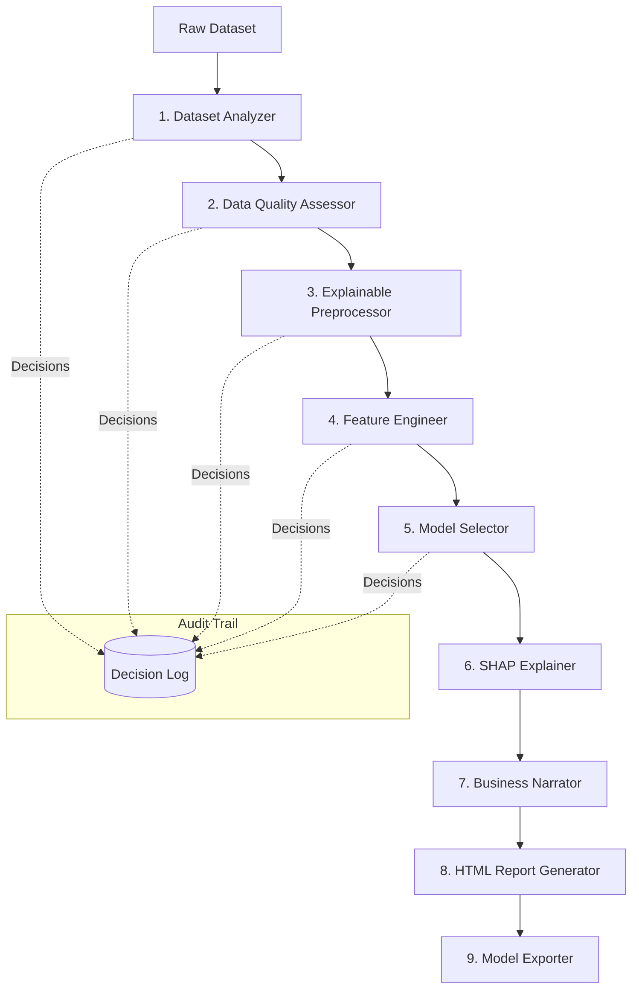

# MentorML — Explainable AutoML Framework

[](https://www.python.org/downloads/)
[](https://github.com/ronitgulia/AutoML-Framework/actions/workflows/ci.yml)
[](LICENSE)
[](https://github.com/psf/black)

> **The AI Data Scientist Copilot** — A production-quality Automated Machine Learning (AutoML) framework that reasons, audits, and narrates like a senior data scientist. Unlike generic black-box AutoML tools that silently optimize metrics, **MentorML explains the *why* behind every decision it makes.**

---

## 🌟 Key Highlights

- 🧠 **Explainable Decision Engine**: Every transformation, imputation, dropped column, and model choice is logged into an immutable `DecisionLog` with human-readable rationale and severity tagging (`INFO`, `WARNING`, `CRITICAL`).
- 📊 **Automated Profiling & Quality Audit**: In-depth dataset profiling, skewness detection, missingness analysis, duplicate detection, and outlier analysis via IQR boundaries.
- ⚙️ **Intelligent Preprocessing & Feature Engineering**: Adaptive categorical encoding, skewness-aware feature scaling, automated interaction generation, polynomial transforms, and correlation pruning.
- 🏆 **Multi-Model Tournament**: Cross-validation benchmarking across top gradient-boosted trees (**LightGBM**, **XGBoost**, **CatBoost**) and classical machine learning models (**RandomForest**, **LogisticRegression**, **Ridge**).
- 🔍 **SHAP Interpretability**: Global and local feature importances powered by TreeSHAP to reveal true feature impact.
- 📝 **Plain-English Business Narratives**: Automated narrative generation translating statistical findings into actionable business insights.
- 📈 **Self-Contained HTML Reports**: Generates interactive dashboards with model leaderboards, data quality assessments, and full audit logs.
- 🚀 **Production-Ready Artifact Export**: Standalone model bundles, preprocessing pipelines, and drop-in inference scripts for zero-friction deployment.

---

## 🏛️ Pipeline Architecture

A single execution of `MentorPipeline.fit()` systematically orchestrates an end-to-end 9-phase lifecycle:



### The 9-Phase Lifecycle

| Phase | Component | Key Responsibilities |
| :--- | :--- | :--- |
| **1. Analysis** | `DatasetAnalyzer` | Column profiling, data types, skewness, target distribution, correlation matrices |
| **2. Quality** | `DataQualityAssessor` | Duplicate detection, outlier inspection, missing value patterns, class imbalance |
| **3. Preprocessing** | `ExplainablePreprocessor` | Adaptive encoding, skewness-aware scaling, intelligent column pruning |
| **4. Features** | `FeatureEngineer` | Interaction terms, polynomial features, and correlation threshold pruning |
| **5. Modeling** | `ModelSelector` | Multi-model cross-validation, hyperparameter evaluation, leaderboard generation |
| **6. Explainability** | `SHAPExplainer` | SHAP summary values, global feature importance ranking |
| **7. Narrative** | `BusinessNarrator` | Plain-English executive summaries and strategic recommendations |
| **8. Reporting** | `HTMLReportGenerator` | Self-contained, responsive HTML dashboard containing charts and audit trails |
| **9. Export** | `ModelExporter` | Serialized artifacts (`.joblib`), pipeline metadata, and standalone `infer.py` |

---

## 🚀 Quick Start

### 1. Installation

Clone the repository and install dependencies:

```bash
git clone https://github.com/ronitgulia/AutoML-Framework.git
cd AutoML-Framework
pip install -r requirements.txt
```

### 2. End-to-End Pipeline in 5 Lines

```python
import pandas as pd
from mentorml import MentorPipeline, MentorConfig

# 1. Load your data
df = pd.read_csv("customer_churn.csv")

# 2. Configure the pipeline
config = MentorConfig(
    target_column="churn",
    task_type="classification",
    cv_folds=5,
    verbose=True,
)

# 3. Fit and generate explanations
pipeline = MentorPipeline(config=config, project_name="Customer Churn Prediction")
result = pipeline.fit(df)

# 4. View executive summary & report
print(result.narrative)
print(f"Interactive HTML Report: {result.report_path}")
print(f"Exported Artifacts Directory: {result.export_dir}")
```

---

## 🔍 The Decision Engine

Unlike standard AutoML tools that operate as a black box, MentorML records every engineering and modeling choice in a structured `DecisionLog`:

```python
from mentorml import DatasetAnalyzer, MentorConfig
from mentorml.core import DecisionLog, Severity

config = MentorConfig(target_column="churn", missing_threshold=0.3)
log = DecisionLog()

analyzer = DatasetAnalyzer(config)
results = analyzer.analyze(df, log)

# Inspect critical issues or warnings
for decision in log.filter(Severity.CRITICAL):
    print(f"[{decision.component}] {decision.action} -> {decision.rationale}")
```

**Example Log Output:**
```
[DataQualityAssessor] flag_class_imbalance -> Target 'churn' has a 92/8 class split. Recommend class_weight='balanced'. (Severity: CRITICAL)
[ExplainablePreprocessor] drop_high_missing -> Column 'profile_pic' has 82% missing values (threshold: 30%). Dropping column. (Severity: WARNING)
[FeatureEngineer] prune_collinear -> Dropped 'tenure_days' due to 0.98 correlation with 'tenure_months'. (Severity: INFO)
```

---

## 📁 Repository Structure

```
AutoML-Framework/
├── mentorml/                   # Core MentorML Python package
│   ├── analysis/               # Phase 1: Column profiling & statistical checks
│   ├── quality/                # Phase 2: Missing, outlier, duplicate inspection
│   ├── preprocessing/          # Phase 3: Explainable data preprocessing
│   ├── features/               # Phase 4: Feature engineering & correlation pruning
│   ├── modeling/               # Phase 5: Multi-model selection & cross-validation
│   ├── explainability/         # Phase 6: SHAP explainers & feature importance
│   ├── narrative/              # Phase 7: Plain-English business summary generator
│   ├── reporting/              # Phase 8: Self-contained interactive HTML dashboards
│   ├── export/                 # Phase 9: Model serialization & inference templates
│   ├── core/                   # Decision engine, protocols, and custom exceptions
│   ├── config.py               # Central dataclass configuration (MentorConfig)
│   └── pipeline.py             # Top-level MentorPipeline orchestrator
├── examples/                   # Walkthrough scripts & demos
│   ├── quickstart.py           # Core decision log and config usage
│   └── phase1_demo.py          # Dataset analyzer live demonstration
├── tests/                      # Comprehensive test suite
│   ├── unit/                   # Unit tests (config, analyzer, decision, features)
│   └── integration/            # End-to-end classification & regression pipeline tests
├── docs/                       # Architecture and developer documentation
├── requirements.txt            # Project dependencies
└── README.md                   # Project overview & documentation
```

---

## 🧪 Running Tests

Run the full pytest suite:

```bash
pytest
```

Run unit or integration tests with coverage:

```bash
# Run unit tests only
pytest tests/unit

# Run integration tests
pytest tests/integration

# Run with coverage report
pytest --cov=mentorml tests/
```

---

## 🛠️ Configuration Options

Customise pipeline behavior with `MentorConfig`:

```python
from mentorml import MentorConfig

config = MentorConfig(
    target_column="target",           # Name of prediction target
    task_type="classification",       # "classification", "regression", or auto-inferred
    cv_folds=5,                       # Cross-validation folds
    missing_threshold=0.30,           # Drop columns with >30% missing values
    correlation_threshold=0.85,       # Prune features with >0.85 collinearity
    outlier_method="iqr",             # Outlier boundary method ("iqr" or "zscore")
    random_state=42,                  # Seed for reproducibility
    verbose=True,                     # Verbose decision console outputs
)
```

---

## 📄 License

This project is licensed under the **MIT License** — see the [LICENSE](LICENSE) file for details.
